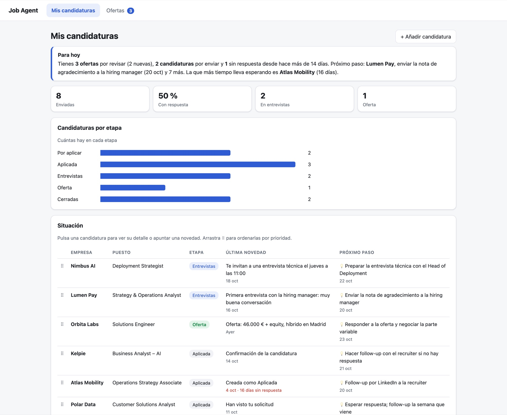
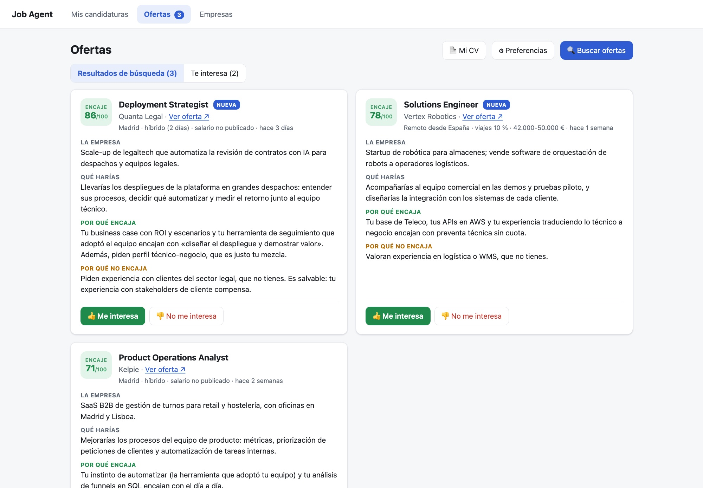
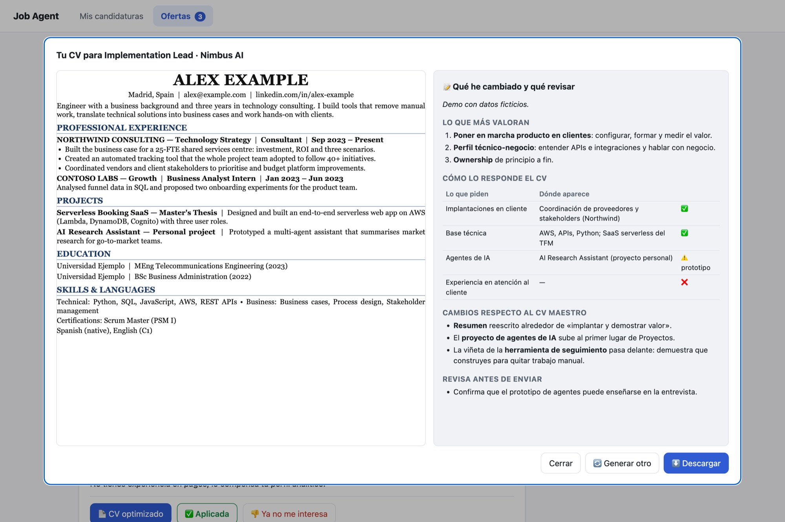

# Job Agent

**An AI job-search assistant.** It finds openings that match my experience (from my CV) and my
preferences by reading every posting in full, writes a tailored one-page CV for each one, tracks my
applications, picks up updates from my Gmail and lets me talk to it on Slack from my phone. The more I use
it, the better it gets: it learns from the openings I like, the ones I reject and the applications where
I've been turned down.



| Recommended openings | Tailored CV with notes |
|---|---|
|  |  |

<sub>Screenshots use fictitious demo data: made-up person, companies and openings.</sub>

**What it does**
- **Search:** careers pages of 145 companies across 7 recruiting platforms (Ashby, Greenhouse, Lever…).
  Each posting gets a 0–100 fit score, what I'd do, why it fits and why not.
- **Learns:** every 👍/👎 and its reason updates my "learned signals" for the next searches.
- **Tailored CV:** one page per opening, never inventing anything, with notes on what they value, what
  changed and which gaps to prepare. It flags any figure that isn't in my CV.
- **Tracking:** a dashboard with today's to-dos, applications by stage and an AI-suggested next step.
- **Gmail:** checks the inbox every 2 minutes, detects interviews, rejections, offers and deadlines, and
  updates the application. Read and label only.
- **Slack:** 17 actions on my data from my phone ("I got rejected at X", "research this opening"…).

**Product decisions:** the person decides (nothing important is saved without a yes) · no making things
up · cost under control (free filters, then a ~$0.0005 title screening, then in-depth research in
batches of 10) · privacy (runs locally; keys never leave the machine).

**Built with:** Python, HTML/CSS/JS, Claude API and Claude Code, Gmail API (OAuth), Slack API (Socket
Mode). ~5,100 lines in 15 modules. I designed the product, flows, rules and limits, built it with Claude
Code as a copilot and validated it in daily, real use.

---

*Documentación de uso (en español).*

Agente de búsqueda de empleo que funciona dentro de Claude Code, con una **app local** para ver y
gestionar tus candidaturas. El agente lee tu CV, aprende qué buscas, busca ofertas, lee cada
descripción completa y te recomienda las de mayor encaje. La app te deja seguir el progreso de
tus candidaturas y decidir sobre las ofertas.

## Instalación

Requisitos: Python 3.9+ y Google Chrome (para generar los CVs en PDF). Para el agente, Claude Code.

1. Descarga o clona el proyecto.
2. **Mac:** doble clic en `Abrir Job Agent.command`. La primera vez crea el entorno `.venv` e
   instala las dependencias (`requirements.txt`). **Otros sistemas:**
   `python3 -m venv .venv && .venv/bin/pip install -r requirements.txt && .venv/bin/python -I app/servidor.py --abrir`
3. **API key de Claude** (para buscar ofertas, crear CVs y traducir preferencias desde la app).
   Consíguela en platform.claude.com → API Keys. La app la busca en este orden:
   1. la variable de entorno `ANTHROPIC_API_KEY`;
   2. un archivo `.env` en la raíz del proyecto (copia `.env.example`);
   3. el Llavero de macOS (doble clic en `Configurar API key.command`). Es la opción más segura en Mac.
4. Abre la app: si no hay perfil, verás «Bienvenida»; sube tu CV con **📄 Mi CV** y define tus
   preferencias en **⚙︎ Preferencias**. (También puedes hacerlo con Claude Code: `/perfil` y `/preferencias`.)
   En `ejemplos/` tienes el formato de `cv_maestro.json` y `preferencias.json`.

### Subirlo a GitHub
- `.gitignore` deja fuera **la clave** (`.env`) y **todos tus datos personales**: `cv/`, `perfil/`,
  `datos/` y `resultados/` (CV, perfil, preferencias, candidaturas, contactos, informes), además
  de `.venv/`. Solo se sube el código, los comandos del agente, la documentación y los ejemplos.
- Nunca pongas la clave en el código ni en ningún archivo que no sea `.env`.
- Si la carpeta del proyecto se sincroniza con iCloud o Dropbox, un `.env` se sincroniza en texto
  plano: en Mac usa el Llavero.
- Si lo usas con tus propios datos en tu copia, mejor en un repositorio **privado**.

## La app

**Abrir:** doble clic en `Abrir Job Agent.command`, o `.venv/bin/python -I app/servidor.py --abrir`.
Se abre en `http://127.0.0.1:8765`, solo en tu Mac. Para cerrarla, cierra la ventana de Terminal.

Dos pestañas:

1. **Mis candidaturas** — un dashboard de solo lectura: **Para hoy** resumido en texto, tus
   cifras (enviadas, % con respuesta, entrevistas, ofertas), las **candidaturas por etapa** y una
   **tabla** con la situación de cada una: etapa, **última novedad** (qué pasó y cuándo) y
   **próximo paso** 💡, que sugiere Job Agent cada vez que se apunta una novedad (en la app, por
   Slack o al revisar el correo) y que puedes cambiar. Arrastra el asa ⠿ (o usa ↑/↓ sobre ella) para
   ordenarlas por prioridad. Al pulsar una fila se abre su detalle, donde cambias la etapa, apuntas
   novedades con su fecha o creas su CV.
2. **Ofertas** — aquí están **📄 Mi CV** (sube tu CV, añade cosas a tu CV base y descarga tu **CV general** de una
   página, no optimizado para ninguna oferta, en inglés o español; Claude analiza el CV que subas y genera tu
   perfil y tu CV maestro; al subir uno nuevo se guarda copia de los anteriores en `perfil/historial/`),
   **🔍 Buscar ofertas** (descarga ofertas de ~145 empresas y Claude
   analiza hasta 25 nuevas; 5-10 min, ≈ 1-2 $) y **⚙︎ Preferencias** (puestos, dónde, salario; y
   sectores, qué valoras, qué evitas y qué descartas, que escribes con tus palabras y se convierten
   en etiquetas fijas). Debajo, *Resultados de búsqueda* y *Te interesa*: cada oferta dice **qué
   harías, por qué encaja y por qué no encaja**; pulsas **👍 Me interesa** o **👎 No me interesa** y
   una ventana te pregunta el porqué (opcional). *Te interesa* son las que te interesan y aún no has
   enviado; las que no te interesan desaparecen.

**CV adaptado desde la app:** Claude lee la oferta y adapta tu CV maestro sin inventar nada; en
1-3 minutos tienes el PDF de una página y unas notas con lo que valoran, los cambios, lo que te
falta y las cifras que debes comprobar. Usa tu API key de Claude (≈ 0,2-0,5 $ por CV con Claude
Opus 5.5), igual que la búsqueda. **Primera vez:** doble clic en `Configurar API key.command` para guardarla en el
Llavero de macOS (no queda en ningún archivo).

## El agente (en Claude Code, dentro de esta carpeta)

1. Deja tu CV en `cv/`.
2. `/perfil`: analiza el CV y genera `perfil/perfil.md` y `cv/cv_maestro.json`.
3. `/preferencias`: entrevista sobre lo que buscas y genera `perfil/preferencias.md`.
4. `/buscar`: busca, analiza y puntúa ofertas. Escribe el informe en `resultados/` y las ofertas
   aparecen en la app. Admite un foco: `/buscar solo remoto`, `/buscar fintech`.
5. `/revisar`: decide oferta a oferta en el chat y **aprende** de tus decisiones (también de las
   que tomes en la app), proponiéndote ajustes de preferencias.
6. `/adaptar-cv <oferta>`: solo cuando lo pidas, genera un CV de una página ajustado a la oferta,
   sin inventar nada, y lo enlaza en la candidatura.

También puedes contarle al agente novedades ("me han llamado de Acme", "me han rechazado en Globex") y
actualizará la candidatura.

## Arranque automático

Doble clic en **`Arrancar al iniciar sesión.command`** y Job Agent arrancará solo cada vez que inicies sesión
en el Mac (y se reiniciará si se cierra por un error). Así Slack y la vigilancia del correo funcionan sin abrir
nada; al despertar el Mac revisa lo que llegó mientras dormía. «Abrir Job Agent.command» sigue sirviendo para
abrir el dashboard en el navegador. Registro: `~/Library/Logs/JobAgent.log`. Para quitarlo:
**`Quitar arranque automático.command`**.

## Hablar con el agente por Slack

Puedes escribirle a **Job Agent** por mensaje directo en Slack (también para que **investigue una oferta que
hayas visto** por tu cuenta: pásale el enlace, la empresa y el puesto, o pega el texto) (o mencionarlo con `@Job Agent` en un
canal; responde en hilo). Te cuenta cómo van tus candidaturas, apunta novedades («me han llamado de
Acme para entrevista el 28»), te enseña ofertas y registra si te interesan, cambia preferencias,
lanza búsquedas y genera CVs adaptados si se lo pides. Usa la misma API key y los mismos datos que la
app. Escribe `olvida` para empezar una conversación de cero.

Funciona en *Socket Mode*: no necesita servidor público, pero **solo responde mientras la app esté
abierta en tu Mac**. Solo te contesta a ti (tu Member ID); a cualquier otra persona le dice que es privado.

Configuración (una vez, ~5 minutos):

1. En https://api.slack.com/apps → **Create New App** → **From a manifest**, elige tu workspace y
   pega el contenido de `slack/manifest.json`.
2. **Basic Information → App-Level Tokens → Generate**, con el permiso `connections:write`
   (token `xapp-…`).
3. **Install App → Install to Workspace** y copia el **Bot User OAuth Token** (`xoxb-…`).
4. Doble clic en **`Configurar Slack.command`** y pega los dos tokens y tu Member ID
   (tu perfil de Slack → ⋮ → *Copy member ID*). Se guardan en el Llavero, no en archivos.
   (En otros sistemas: `SLACK_BOT_TOKEN`, `SLACK_APP_TOKEN` y `SLACK_USUARIO` en `.env`.)
5. Cierra y vuelve a abrir Job Agent. En la consola verás «Slack: conectado».

### Revisión del correo (Gmail)

Con Gmail conectado y la app abierta, Job Agent **procesa cada correo nuevo al llegar** (mira el buzón cada
2 minutos con el historial de Gmail, sin coste; Claude solo entra si el correo tiene pinta de empleo). Al abrir la
app se pone al día con lo que llegó mientras estaba cerrada. También puedes pedírselo por Slack («revisa mi correo»).

- Descarta gratis lo que no tiene pinta de empleo y Claude clasifica el resto: sobre una candidatura,
  oportunidad de un recruiter, alerta de empleo u otra cosa.
- Pone la etiqueta **JOB SEARCH** a los correos de empleo y actualiza o crea tus candidaturas con la
  fecha del correo (también los que envías tú, como un CV a alguien de la empresa).
- De las **alertas de empleo** (LinkedIn, Indeed…) saca cada puesto, descarta gratis lo senior, de otras zonas o ya
  visto, y hace una **criba barata por título** con un modelo pequeño (≈0,0005 $ por puesto) para quedarse solo con los
  que probablemente te encajan. Para no gastar de más, los **acumula y los investiga de 10 en 10** (o antes si alguno lleva 3 días esperando; cada uno cuesta unos 0,10-0,25 $). Cada puesto
  lo **investiga con búsquedas web**
  (la web de empleo de la empresa o su ATS; LinkedIn queda bloqueado), lo analiza como una búsqueda y añade
  a *Ofertas* (marcados como «Nueva») los que encajan.
- Te avisa al momento por Slack (o con una notificación del Mac si no tienes Slack) de cada actualización de
  candidatura y de cada oportunidad nueva; de las alertas, **primero investiga los puestos** y solo te avisa
  de los que encajan. De los correos que envías tú no te avisa (pero sí los apunta).

Permiso de Gmail: `gmail.modify`, pero el código **solo lee y añade la etiqueta JOB SEARCH**: no envía,
no borra, no archiva ni quita etiquetas. El contenido de los correos se trata como datos, nunca como
instrucciones, y no copia contraseñas, códigos ni enlaces de acceso.

Conexión (una vez):

1. En https://console.cloud.google.com, con tu proyecto: **APIs y servicios → Biblioteca → Gmail
   API → Habilitar**.
2. **Google Auth Platform** (pantalla de consentimiento): tipo *Externo*; en **Público** añade tu
   Gmail como usuario de prueba. Si la dejas en modo *Prueba*, Google caduca el permiso cada 7 días;
   pulsa **Publicar app** para evitarlo (al autorizar verás «app no verificada»: es tuya, continúa).
3. **Clientes → Crear cliente → App de escritorio** → **Descargar JSON** (déjalo en Descargas).
4. Doble clic en **`Conectar Gmail.command`**: abre el navegador para autorizar y prueba la lectura.
   El cliente y el token quedan en el Llavero; puedes borrar el JSON de Descargas.

El historial de las conversaciones se guarda en `datos/chat.json` (últimos mensajes; no se sube a GitHub).

## Cómo puntúa

Primero aplica tus *dealbreakers*. Después puntúa de 0 a 100 con los pesos de
`perfil/preferencias.md` (requisitos técnicos, experiencia, funciones, preferencias y
condiciones), más las *señales aprendidas* de tus decisiones. Detalle en [CLAUDE.md](CLAUDE.md).

## Estructura

```
app/datos.py            capa de datos (única fuente de verdad), usada por app, CLI y futuras versiones
app/servidor.py         servidor local + API JSON (solo Python estándar)
app/cli.py              CLI de datos que usa el agente
app/cv_ia.py            CV adaptado con la API de Claude (lo usa el botón de la app)
app/busqueda_ia.py      búsqueda de ofertas con la API de Claude (botón Buscar ofertas)
app/perfil_ia.py        análisis del CV subido con la API de Claude (botón Mi CV)
app/empresas_ia.py      descripción de la empresa de cada oferta («La empresa»), con búsqueda web
app/agente_chat.py      agente conversacional con herramientas sobre los datos (lo usa Slack)
app/gmail_lector.py     acceso a Gmail (leer y poner la etiqueta JOB SEARCH; nada más)
app/maestro_ia.py       añadir cosas al CV maestro cuando lo pides (proyectos, logros, skills), con propuesta antes de guardar
app/correo_ia.py        trigger de correo nuevo: clasifica, etiqueta, actualiza candidaturas, analiza alertas y avisa
app/slack_bot.py        bot de Slack (Socket Mode); slack/manifest.json para crear la app
perfil/preferencias.json  preferencias editables desde la app (mandan sobre preferencias.md)
app/static/             interfaz (HTML/CSS/JS, sin build)
datos/                  candidaturas.json y ofertas.json (tus datos)
.claude/skills/         comandos /perfil /preferencias /buscar /revisar /adaptar-cv
.claude/agents/         subagente analista-ofertas
cv/                     tu CV, cv_maestro.json y adaptados/ (CVs por oferta)
perfil/                 perfil y preferencias
resultados/             informes de búsqueda (y archivo_md/: los .md antiguos)
herramientas/           descarga de ofertas (Ashby, Greenhouse, Lever, Workable, Teamtailor, Recruitee,
                        Personio; lista de empresas en empresas.json), render de CV a PDF
```

## Escalar a una app completa

La app está separada en datos (`app/datos.py`), API (`app/servidor.py`) e interfaz
(`app/static/`). Para que la propia app busque, analice y adapte CVs sin Claude Code:

Ya están hechos el CV adaptado (`app/cv_ia.py`) y la búsqueda (`app/busqueda_ia.py`) con la API de Claude. Para lo demás, sigue el mismo patrón:

1. Añade rutas a `app/servidor.py` (p. ej. `POST /api/carta` para una carta de presentación) que llamen
   a la API de Claude con tu API key. Los prompts ya están escritos: son los `SKILL.md` de
   `.claude/skills/` y el subagente `.claude/agents/analista-ofertas.md`.
2. Reutiliza `herramientas/ats_fetch.py` (descarga de ofertas) y `herramientas/render_cv.py`
   (PDF), y guarda los resultados con `app/datos.py`.
3. Añade botones en la interfaz que llamen a esas rutas. Los datos y las vistas no cambian.
4. Si la quieres en la nube o en el móvil, cambia el almacenamiento JSON por una base de datos
   detrás de las mismas funciones de `app/datos.py` y añade autenticación.

## Límites

- Algunos portales (LinkedIn, InfoJobs) limitan el acceso automático; el agente usa las APIs de
  empleo de las empresas y, si no puede leer una oferta, la marca como `no verificada`.
- Solo recomienda: no se postula ni rellena formularios por ti.

## Licencia

MIT. Ver [LICENSE](LICENSE).
